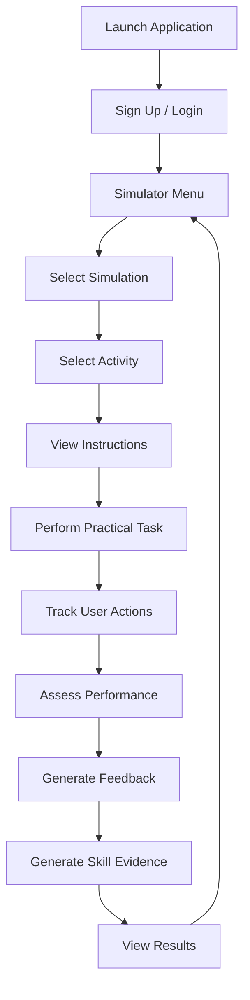
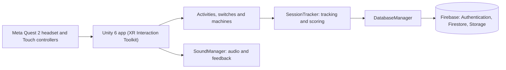

# Skill-Proof

> An immersive VR platform for demonstrating and assessing practical skills and providing performance evidence.

## Description

**Skill-Proof** is a VR capstone project that allows users to perform selected practical skills in an immersive virtual environment and have their performance assessed.

**Problem:** People may have practical skills gained through education, vocational training, informal learning, apprenticeship, or work experience but may have limited practical evidence to demonstrate what they can do. This can make it difficult for employers to understand a person's demonstrated practical ability.

**Solution:** Skill-Proof provides predefined practical VR activities where users perform tasks while the system tracks their actions, assesses their performance, and generates skill evidence that can help communicate demonstrated competency to employers and other stakeholders.

### Key features

* Predefined practical VR activities for electrical wiring and solar panel installation.
* Interactive 3D environments with virtual tools and equipment.
* Step-by-step activities that complete only when the **correct object** is placed in the **correct socket**, and are undone if a component is removed again.
* Safe-working rules: breakers must be switched **off** before working on a circuit, and wrong or unsafe actions are detected and scored.
* Testable circuits: after wiring, the player flips a test switch and the light bulb, stove, geyser or solar inverter runs, or sparks if the circuit is not ready.
* Spatial sound effects and visual feedback (pick up, drop, socket snap, switches, machines, electric sparks) with SFX and ambience volume sliders.
* Safety gloves (PPE) that replace the bare hands when equipped.
* Tutorial video on a screen in the start menu.
* Performance tracking and assessment: accuracy, errors, safety compliance, procedural order, completion time and competency level.
* Loading screen, pause menu, and a restart that resets the whole scene and all activities.
* On-screen task progress, timer and hints during the simulation, and a results screen when it ends.
* Performance results saved online, and a digital skill evidence PDF generated from the results.
* User accounts with sign up and login using Firebase Authentication, with an on-screen keyboard in VR.

## Links

| Resource          | Link                                                                                                                                                    |
| ----------------- | ------------------------------------------------------------------------------------------------------------------------------------------------------- |
| GitHub repository | [Skill-Proof GitHub](https://github.com/Wakhi-Ken/Skill-Proof-An-Immersive-Simulation-Platform-for-Demonstrating-Assessing-Practical-Skills-Competency) |
| Figma designs     | [Skill-Proof on Figma](https://www.figma.com/design/C4MHMWXMz2jBHC4t71BWcv/Skill-Proof?node-id=0-1&p=f&t=zkOPKaTbnOLc6Ktw-0)                            |
| Demo video        | [Skill-Proof Demo](https://youtu.be/t-jPYAJS5Cg)                                                                                                        |

## Setup: Environment and Project

### Prerequisites

| Requirement          | Version / Notes          |
| -------------------- | ------------------------ |
| Game engine          | Unity 6                  |
| Programming language | C#                       |
| XR SDK               | XR Interaction Toolkit   |
| VR headset           | Meta Quest 2             |
| Input                | Quest Touch controllers  |
| OS                   | Windows                  |
| Version control      | Git / GitHub             |
| Backend              | Firebase                 |
| Development tools    | Unity Hub, Visual Studio |

### Installation

```bash
# 1. Clone the repository

git clone https://github.com/Wakhi-Ken/Skill-Proof-An-Immersive-Simulation-Platform-for-Demonstrating-Assessing-Practical-Skills-Competency.git

# 2. Enter the project folder

cd Skill-Proof-An-Immersive-Simulation-Platform-for-Demonstrating-Assessing-Practical-Skills-Competency
```

Open the project using **Unity Hub** and select the Unity 6 version used to develop the project.

### Configure the project

1. Open the project in Unity.
2. Open **Edit → Project Settings → XR Plug-in Management**.
3. Configure the Android/VR platform for Meta Quest 2.
4. Open **Window → Package Manager** and ensure the required XR packages are installed.
5. Configure Firebase Authentication and other Firebase services used by the project.
   * Simulation and activity data is loaded from Firestore (it can be added with `SimulationSeeders`). `SessionTracker.simulationId` must match a simulation document ID.
6. Open **File → Build Profiles** and make sure all scenes are in the scene list. The names must match the menu buttons exactly: `Main Menu`, `Simulation Menu`, `SImulation 1`, `SImulation 2`.
7. Audio: the SoundManager needs an Audio Mixer with the exposed parameters `SFXVol` and `AmbienceVol`, and volume sliders named `SFXSlider` and `AmbienceSlider`.
8. Open the **Main Menu** scene.

### Run the project

**In the Unity Editor:**

Press **Play** to test the application.

**On Meta Quest 2:**

1. Enable Developer Mode on the headset.
2. Connect the headset to the development computer.
3. Select **File → Build Profiles** and configure an Android build.
4. Build and install the application on the Meta Quest 2.

## Designs

### Figma mockups and prototype

Full prototype:

[Open Skill-Proof in Figma](https://www.figma.com/design/C4MHMWXMz2jBHC4t71BWcv/Skill-Proof?node-id=0-1&p=f&t=zkOPKaTbnOLc6Ktw-0)

The Figma prototype covers the main user interface, application flow, simulation selection, practical activities, performance results, and skill evidence.

### Interaction Flow



### System / Hardware Diagram



### App Screenshots


## How the simulation works

### Activities and tasks

* Each activity is made of several tasks. A task is an `ActivityTrigger` linked to an activity ID.
* A task completes only when the **specific correct object** (or tag) is inside its socket. A wrong object only plays an alert sound.
* If a component is removed again, its task is undone and the whole activity stops being reported as complete, at any time during the session.
* An activity is complete when all of its tasks are complete. Completion order is judged the first time each activity is completed.

### Safe working and testing

* The player must switch the circuit's **breaker off** before working. Working with the breaker on causes sparks and a safety violation.
* After the circuit is built and the breaker is switched back on, the player flips the **test switch** (bulb switch, stove, geyser, inverter).
* If the activity is not complete, or a wrong object is still in a wrong place, the test sparks and registers an error. If everything is correct, the machine runs with glow, light and sound.
* Removing a component or switching the breaker off while a machine runs stops the machine.

### Errors and scoring

* Entering a wrong-place zone (`ErrorTrigger`) only plays an alert sound. The error is registered when the simulation finishes if the wrong object is still there.
* `SessionTracker` calculates safety score, accuracy, procedural score, completion and competency, and gives a competency level and feedback. The result is saved to Firestore.

### Sound and feedback

* Pick up, drop and socket-snap sounds play automatically for every grabbable object.
* Breaker, light switch, spark, machine start and machine loop sounds are played in 3D space.
* SFX and ambience volumes are controlled by sliders and are saved between sessions.
* The controllers vibrate on pick up and when sparks happen.

### Accounts, results and evidence

* Users sign up or log in with Firebase Authentication. Text fields use an on-screen keyboard in VR.
* During a session the UI shows task progress, the time, and hints from the `HintsManager`.
* When the simulation ends, a results screen shows the performance, and a skill evidence PDF is generated from the saved results.
* The logged-in user stays until they log out.

### Scene changes and restart

* Every scene change goes through a loading screen and loads the scene fresh.
* Restart reloads the current scene and resets every object and all activities. Only the logged-in user and the audio settings carry over.

## Scripts overview

All scripts are in `Assets/Scripts`, grouped by folder.

| Folder | Script | Purpose |
| ------ | ------ | ------- |
| Data | `ActivityResult` | Result of one activity (completed, errors) stored in the performance record. |
| Data | `EvidencePdf` | Data used to build the skill evidence PDF. |
| Data | `PerformanceData` | The performance record saved for a session: scores, competency level, time, errors and activity results. |
| Data | `UserData` | The user's profile data. |
| Managers | `ActivityTestable` | Per-activity testing: breaker and test switch rules, spark and error rules, and starting or stopping the machine. |
| Managers | `DatabaseManager` | Firebase / Firestore access used to load simulations and save performance. |
| Managers | `EvidenceSaver` | Creates and saves the skill evidence from the performance results. |
| Managers | `FirebaseManager` | Starts Firebase and its services. |
| Managers | `HintsManager` | Shows hints and feedback messages to the player. |
| Managers | `LoginManager` | Logs the user in with Firebase Authentication. |
| Managers | `MachineSFX` | Machine behaviour for the light bulb, stove, geyser and solar inverter: glow, lights, start and loop sounds. |
| Managers | `SessionTracker` | Runs the session: loads the simulation, tracks activity results, errors, safety violations and time, calculates scores and competency, and saves the performance. |
| Managers | `SignupManager` | Creates new user accounts. |
| Managers | `SimulationData` | Data model of a simulation and its activities, loaded from Firestore. |
| Managers | `SimulationSeeders` | Adds the simulation and activity data to Firestore. |
| Managers | `SoundManager` | Persistent audio manager: mixer volumes, per-scene ambience, task/complete/wrong sounds, 3D sound pool, automatic grab/drop/snap sounds, spark, breaker, light switch and machine sounds. |
| Managers | `XRToggleSwitch` | Reusable on/off switch for breakers, the bulb switch, and the stove, geyser and inverter test switches. |
| Menu Navigation | `MenuNavigation` | Scene loading with the loading screen, pause and resume, and restart. |
| Player | `ForceObjectToFall` | Helper that makes an object fall under gravity. |
| Player | `GloveEquip` | Safety gloves pick-up: shows the gloves, hides the bare hands and completes the glove task. |
| Simulation | `ActivityTrigger` | One task of an activity. Checks the correct object and socket, undoes the task when the object is removed, and reports activity completion. |
| Simulation | `ErrorTrigger` | Wrong-place zones: alert sound on entry, error registered at the end if the wrong object is still there. |
| UI | `CompleteSimulationUi` | Screen shown when the simulation is finished. |
| UI | `DetailedGeneratedUI` | Detailed results screen built from the performance data. |
| UI | `MultiFieldKeyboardDisplay` | On-screen keyboard for typing in several fields, such as login and sign up. |
| UI | `Quicklogin` | Quick login option on the login screen. |
| UI | `TaskProgressUI` | Shows the progress of the activities and tasks. |
| UI | `TimeDisplay` | Shows the session time. |
| UI | `UserProfileUI` | Shows the user's profile. |

The tutorial video in the start menu uses Unity's built-in **Video Player** on a screen object, with Play and Stop buttons, and needs no script.

## Assets

| Asset                       | Type      | Purpose / Justification                              | Source            |
| --------------------------- | --------- | ---------------------------------------------------- | ----------------- |
| Virtual tools and equipment | 3D models | Used to create the practical simulation environments | Own / Free assets |
| Electrical components       | 3D models | Used for the electrical wiring simulation            | Own / Free assets |
| Solar panel components      | 3D models | Used for the solar installation simulation           | Own / Free assets |
| UI icons                    | 2D        | Used for menus and interface elements                | Own / Free assets |
| Breaker colour key          | 2D image  | Shows which breaker colour belongs to which circuit  | Own               |
| Sound effects and ambience  | Audio     | Pick up, drop, snap, switches, sparks, machines      | Free assets       |
| Tutorial video              | Video     | Explains how to use the simulation in the start menu | Own               |

## Hardware Integration

* **Device:** Meta Quest 2
* **Input:** Quest Touch controllers
* **Development platform:** Unity 6 + XR Interaction Toolkit
* **Programming:** C#

| User action        | Hardware input           | Result in the experience                          |
| ------------------ | ------------------------ | ------------------------------------------------- |
| Select an object   | Controller trigger       | Object is selected/interacted with                |
| Grab an object     | Controller trigger/grip  | Virtual object can be manipulated                 |
| Place in a socket  | Release near the socket  | Object snaps in and the task is checked           |
| Flip a switch      | Controller select        | Breaker or test switch turns on or off            |
| Play the tutorial  | Controller select        | Tutorial video plays or stops                     |
| Move around        | Controller thumbstick    | User moves through the environment                |
| Look around        | Head movement            | User views the virtual environment                |
| Feel feedback      | Controller vibration     | Buzz on pick up and when sparks happen            |
| Complete an action | Controller interaction   | System records the action                         |
| Pause              | UI button                | Simulation is paused                              |

## Deployment Plan

1. **Build:** Create an Android build of the Unity application for Meta Quest 2.
2. **Testing:** Install the application on the headset and test the two practical simulations.
3. **User Evaluation:** Test the prototype with a selected sample of users.
4. **Backend:** Use Firebase Authentication, Cloud Firestore, and Cloud Storage for the required online services.
5. **Distribution:** Initially distribute the application through direct APK installation/sideloading for testing.
6. **Future Deployment:** A future version could be distributed through an appropriate Meta Quest application distribution platform.
7. **Maintenance:** Continue fixing bugs and improving the application based on testing and user feedback.

## Project Structure

```text
Skill-Proof/
│
├── Assets/
│   ├── _Recovery
│   ├── Animations
│   ├── Audio
│   ├── CompositionLayers
│   ├── Editor Default Resources
│   ├── ExternalDependencyManager/
│   │   └── Editor
│   ├── FireBase
│   ├── Fonts
│   ├── GeneratedLocalRepo
│   ├── Materials/
│   │   ├── Blocks
│   │   ├── Floor
│   │   ├── Ground
│   │   └── TV Stand
│   ├── Models/
│   │   ├── Electric wiring scene
│   │   ├── HOuses
│   │   ├── Player
│   │   ├── Solar Scene
│   │   └── Start Menu
│   ├── Plugins
│   ├── Prefebs
│   ├── Resources
│   ├── Samples
│   ├── Scenes/
│   │   ├── BasicScene
│   │   └── SampleScene
│   ├── Scripts/
│   │   ├── Data
│   │   ├── Managers
│   │   ├── Menu Navigation
│   │   ├── Player
│   │   ├── Simulation
│   │   └── UI
│   ├── Settings
│   ├── Skybox
│   ├── StreamingAssets
│   ├── TextMesh Pro
│   ├── Textures
│   ├── UI
│   ├── URPDefaultResources
│   ├── VRTemplateAssets
│   ├── XR
│   └── XRI
│
├── Packages/
│
├── Liv Creator Kit/
├── docs/
│   ├── designs/
│   └── screenshots/
│
└── README.md
```

## Project Scope

The current prototype contains two predefined practical simulation workflows for users:

1. **Electrical Wiring Installation**
2. **Solar Panel Installation**

All the features described above are implemented and working in the current prototype, including the integrated system logic that tests competency (activities, safety rules, circuit testing, error tracking, scoring and saving performance).

## Developer

| Name            | Role                                     |
| --------------- | ----------------------------------------- |
| Wakhile Dlamini | Software Engineering Student / Developer |
